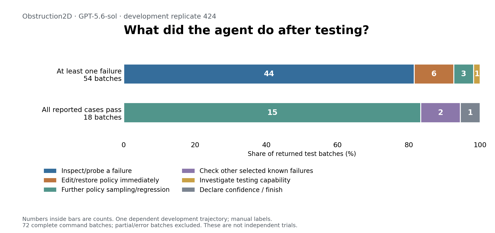

# Obstruction2D 424 — findings and your notes

[Timeline](01_timeline.md) · [All commits and changed lines](02_code_changes.md) · [Task](evidence/task.md) · [Final controller](evidence/final/approach.py)

Status: **prior manual findings, ten-case pilot, and a full-run feasibility audit**. Start with the [full-run results and proposed experiment](#full-run-feasibility) or the [complete test-decision ledger](#full-test-ledger). Earlier findings were migrated for review. The [ten-case table](#ten-case-pilot), added 2026-10-11, inspects the first ten completed policy-test batches containing failures. Neither section is a causal experiment or formal ACT*ONOMY annotation. Add your notes at the bottom; rebuilding the timeline preserves this file.

## Three places to start reading

1. **Investigate versus repair:** [E0401](01_timeline.md#E0401) → [E0404](01_timeline.md#E0404) → [E0407](01_timeline.md#E0407) → [E0409](01_timeline.md#E0409) → [E0411](01_timeline.md#E0411).
2. **A stated explanation followed by a matching edit:** [E0389](01_timeline.md#E0389) → [E0391](01_timeline.md#E0391) → [E0392](01_timeline.md#E0392) → [R39](02_code_changes.md#R39) → [E0396](01_timeline.md#E0396).
3. **The five familiar repairs:** [R34](02_code_changes.md#R34) → [R35](02_code_changes.md#R35) → [R36](02_code_changes.md#R36) → [R37](02_code_changes.md#R37) → [R38](02_code_changes.md#R38). The old seed-18 before/after example is R34, not the initial code.

For each sequence, stop before the next action and write what you expect the agent to do. Then inspect the exact message, edit and test output.

## Controller assessment

The final controller uses a greedy geometric task/parking plan, intended future occupancy reservations, and feedback phases for grasping, lifting, moving and releasing. It includes anticipatory constraints intended to preserve later pickups. Explicit multi-step route search or rollouts of alternative action sequences were not found in the inspected final code. “No representation of future consequences” would therefore be too strong, as would “model-free RL.”

Distinguish this controller assessment from the coding agent's observable explanations and experiments. See R37 and R39 below. The final policy is `4897e46`; the first policy is `b59ebec`, available through the change guide.

## Findings to revisit

### F001 — Expands tests before visibly repairing every known failure

**Observed:** [E0401](01_timeline.md#E0401) reports ordinary seed 85 failing → [E0404/E0406](01_timeline.md#E0404) inspect reset options → [E0407](01_timeline.md#E0407) connects pinned counts with the task requirement → [E0409](01_timeline.md#E0409) changes the tester → [E0411](01_timeline.md#E0411) tests three obstructions. No intervening visible targeted seed-85 policy repair.

**Interpretation:** checking a coverage gap can take priority over a known failure. **Alternative:** this was a separate evaluation requirement, not information gathering intended to explain seed 85. **Next check:** compare next substantive actions after both successes and failures, including cases that do not fit this pattern. **Status:** supported sequence; motivation remains uncertain.

### F002 — An unsuccessful attempt becomes a broad world claim

**Observed:** [E0035](01_timeline.md#E0035) says obstruction lifting does not work; later exploration includes successful lifting, and [R01](02_code_changes.md#R01) implements lifting phases.

**Interpretation:** a procedure-specific failure may initially be attributed to a general environmental limitation. **Alternative/limit:** the observations may differ in approach conditions; no explicit acknowledgment of the earlier overgeneralization was found in the prior inspection. **Next check:** compare the exact contact conditions and the changing scope of the messages. **Status:** conflicting recorded evidence; private belief revision is not established.

### F003 — Changes the controller's organization

**Observed:** initial reactive baseline → extensive probes → [R01](02_code_changes.md#R01) introduces feedback phases and retries. Later [R18](02_code_changes.md#R18) introduces geometric parking selection. The agent also revises the tester during early development.

**Interpretation:** some revisions change the solution's structure, not just constants. **Alternative/limit:** several changes occur together, so a later outcome does not isolate the effect of phases. **Next check:** compare the initial policy with R01 and record each phase and its entry/exit conditions. **Status:** structural edits supported.

### F004 — Simplifies the tested problem before diagnosing a component

**Observed:** placement failures → [E0161](01_timeline.md#E0161) finds zero-obstruction scenes → [E0163](01_timeline.md#E0163) tests them and still fails → further grasp/motion probes → [R12](02_code_changes.md#R12) uses finer downward movements.

**Interpretation:** simpler cases can narrow a failure explanation. **Alternative/limit:** sampled scenes also differ in other properties; this is not a controlled removal of obstacles. **Next check:** read the competing explanations at [E0155](01_timeline.md#E0155). **Status:** diagnostic sequence supported.

### F005 — A local repair causes regressions elsewhere

**Observed:** R34 solves seed 18 → R35 improves seeds 39/45 but breaks seed 3 → R36 restores seed 3. R37 improves seeds 15/26; a later test finds seed 18 failing again → R38 changes ordering.

**Interpretation:** development involves tradeoffs and conditional refinements, not steady improvement. **Next check:** inspect matched seeds, counts and harness versions in [R34–R38](02_code_changes.md#R34). **Status:** historical test outcomes supported; no pooled success-rate estimate.

### F006 — Adds constraints for later actions

**Observed:** [E0374](01_timeline.md#E0374) explains interference with future pickups → [R37](02_code_changes.md#R37) protects future pickup locations while also changing a height tolerance. [E0392](01_timeline.md#E0392) proposes outer-first parking → [R39](02_code_changes.md#R39) changes candidate sorting → [E0396](01_timeline.md#E0396) reports success on seed 59 and the accompanying baseline batch.

**Interpretation:** stated causal explanations can lead to simpler anticipatory rules. **Alternative/limit:** the trace does not prove those statements caused the edit or that the physical explanation is complete. R37 changes two rules together. **Next check:** compare predicted consequences stated before a test with post-test explanations. **Status:** explanation/edit alignment supported; internal simulation not established.

### F007 — Returns to earlier controller contents

**Observed:** R26/R27 introduce and adjust high carries with poor selected results → R28 removes that mechanism → further reversals follow. Complete controller contents repeat exactly for R24/R29, R25/R28 and R30/R32, as recorded by hashes in the change guide.

**Interpretation:** abandonment/rollback is a distinct choice from incremental tuning. **Next check:** record the feedback accumulated before each reversal. **Status:** exact revisits supported; no resource-rationality conclusion.

### F008 — Distinguishes coverage failure from robot failure

**Observed:** attempts at count five fail during scene initialization at [E0426](01_timeline.md#E0426), [E0449](01_timeline.md#E0449), and [E0504](01_timeline.md#E0504).

**Interpretation:** these are unexecuted policy tests, not failed robot episodes. **Next check:** preserve reset failures as their own outcome category. **Status:** recorded initialization failures.

### F009 — Skips work made unnecessary by an earlier action

**Observed:** [E0514](01_timeline.md#E0514) describes one moved blocker displacing another → [R51](02_code_changes.md#R51) adds a live relevance check → [E0518](01_timeline.md#E0518) reports success on the targeted case.

**Interpretation:** fixed planned work is supplemented by checking the current scene. **Alternative/limit:** reacting to a useful side effect is not evidence that the controller predicted that side effect in advance. **Status:** implementation and selected outcome supported.

### F010 — Stopping and resuming are visible, but their causes are not fully known

**Observed:** first handoff retains uncertainty → the same run resumes → later [E0521](01_timeline.md#E0521) states a validation condition → [E0523](01_timeline.md#E0523) reports 15/15 → confidence declaration and final handoff.

**Interpretation:** stopping criteria can be studied from visible evidence. **Alternative/limit:** continuation may be harness-driven; budget visibility alone does not establish rational resource allocation. **Status:** sequence supported; stopping mechanism open.

## Reasoning availability and helper evidence

The prior audit found 287 encrypted reasoning records across eight saved rollout files, with no nonempty readable reasoning summary/content. Counts are records, not unique thoughts; inherited history can repeat. Readable main and helper messages still exist. Selected helper proposals, including diagnostic predictions, are preserved in [the excerpts](evidence/model_evidence_excerpts.md) and [audit data](evidence/model_evidence.json). Proposed helper actions are not proof of execution or adoption.

## Earlier figures

The original figures are preserved here: [development timeline](evidence/figures/01_development_timeline.png), [fixed-case performance](evidence/figures/02_fixed_cases_performance.png), and [case outcomes](evidence/figures/03_case_outcomes.png). They summarize the earlier reconstruction, not new evaluations. Original figure sources and all prior notes remain in the migration backup.

## First ten completed policy-test batches with failures — manual pilot

**Added 2026-10-11.** Model: Codex `gpt-5.6-sol`, medium effort. Development replicate: **424**. The seeds below (such as 11 or 1) are **test episode seeds inside this one development run**. They are not ten different agent runs.

Read the table first. The short case notes below explain the evidence, ambiguities and actual code changes. These are initial analyst labels for your review, not formal ACT*ONOMY annotations or measurements of private reasoning.

### How these ten were selected

I scanned the main transcript from its beginning and selected the first ten returned **end-to-end policy-test batches with an explicit failed episode and a completed result summary**. One returned batch is one row, even when several seeds fail. The selected feedback events are E0079, E0088, E0094, E0099, E0106, E0112, E0118, E0124, E0132 and E0144. E0130 is a successful-only batch between cases 8 and 9 and is retained below as context, not counted as a failure case.

This operational rule excludes short hand-scripted mechanics probes, intermediate `terminated=False` flags, interrupted tests and command errors from being separate failure cases. Those records are still used to identify investigation and follow-through. Thus these are **not the first ten unsuccessful actions of any kind**, nor every failure in the run. All ten selected batches report failed episodes reaching 1,000 steps. The harness returns the termination flag as its reported success value; these are saved development-test reports, not fresh independent evaluations.

**What happened before case 1:** [E0011](01_timeline.md#E0011) runs a one-step scene probe with the initial baseline. [E0020](01_timeline.md#E0020) later shows that baseline repeatedly issuing an arm-extension action, with output reaching step 8,825 before the command ends with exit 143 and no result summary. [E0022](01_timeline.md#E0022) reruns with output piped through `head` and ends with `BrokenPipeError`; it also has no completed episode report. [C003](02_code_changes.md#C003) confirms that the initial tester lacked its own step cap; [C004](02_code_changes.md#C004) adds `steps < env.max_steps` while replacing the controller. Many mechanics probes occur in between. These early records contain meaningful problems, but mixing them with completed policy batches would change the unit of analysis.

**How actions are labeled:** skip process polling, waiting and commit bookkeeping when finding the next substantive action. Check command start lines so a previously launched command is not mistaken for a response to later feedback. “Investigation” means an extra probe or replay intended, by its design or an explicit statement, to examine the failure before changing the saved policy. A probe may try different robot actions without editing `approach.py`. “Broader testing” expands the tested cases for the current policy; it can be ordinary validation rather than an attempt to diagnose a particular failure. “Repair” would mean the next substantive action changes policy behavior. We also record later repairs instead of treating these choices as mutually exclusive over a whole development sequence.

### Ten-case table

“Not explicit” in the acknowledgment column means **no main-agent prose acknowledgment in the local window through the next completed policy-test batch**. It does not mean that the agent ignored the feedback. Commit titles and code comments can state a proposed change's purpose; they are distinguished from an explanatory message before the action.

| Case | Feedback available to the agent | Explicit acknowledgment? | First substantive action afterward | Working label | Stated purpose / evidence limit | Later change and observed follow-through |
| --- | --- | --- | --- | --- | --- | --- |
| [1](#case-01) | [E0079](01_timeline.md#E0079), [C004](02_code_changes.md#C004): seed 11, zero obstructions, **0/1 solved**; repeated descent/retry motion. | Yes, a grasp problem is described in [E0084](01_timeline.md#E0084), **after** the first probes; the seed is not named. | [E0081](01_timeline.md#E0081): manually approach and attempt to lift the target in the same scene; then try grasp angles. | **Targeted investigation** | E0084 claims a narrow-object grasp limitation and proposes orientation-aware fallbacks. That is a diagnosis/proposal, not a verified impossibility or an implemented repair. | [E0083](01_timeline.md#E0083) reports zero lift for all six angles; [E0086](01_timeline.md#E0086) prints no successful candidate. No visible policy edit before [E0088](01_timeline.md#E0088), which tests seeds 1–3 and reports 0/3. |
| [2](#case-02) | [E0088](01_timeline.md#E0088), C004: seeds 1–3, **0/3 solved**. | Not explicit. | [E0090](01_timeline.md#E0090): replay failed seed 1, printing phase, retries and object positions. | **Targeted investigation** | Later [C005](02_code_changes.md#C005) names the intended change: use the reset pose as a reachable travel height. No preceding prose explanation is saved in this window. | The trace stays in `rise`. [E0092](01_timeline.md#E0092)/C005 replace fixed rise/retreat thresholds with reset height. [E0094](01_timeline.md#E0094): seed 1 passes; seeds 2–3 still fail, **1/3**. |
| [3](#case-03) | [E0094](01_timeline.md#E0094), [C005](02_code_changes.md#C005): seed 1 now passes, but seeds 2–3 fail, **1/3 solved**. | Not explicit. | [E0099](01_timeline.md#E0099), launched at line 95: test seeds **0–11 with the same policy**. | **Broader testing / coverage check** | No explicit purpose message. Broader validation after the recent fix is an alternative to interpreting this as investigation caused by the two remaining failures. | No intervening visible policy edit. The larger batch reports **1/12**, with seed 1 the only success. Its response becomes case 4. |
| [4](#case-04) | [E0099](01_timeline.md#E0099), C005: seeds 0–11, **1/12 solved**; failures occur with zero, one and two obstructions. | Not explicit. | [E0102](01_timeline.md#E0102): replay failed seed 2 and print phases, attachment flags and positions. | **Targeted investigation** | Later C006's comment says pre-parking the target matters when it shields another object. That stated rationale is checked against the diff, not assumed to explain every failure. | The target moves while intended obstructions remain. [E0104](01_timeline.md#E0104)/[C006](02_code_changes.md#C006) change task order and pre-park the target. [E0106](01_timeline.md#E0106): **0/4**; seed 1 regresses. |
| [5](#case-05) | [E0106](01_timeline.md#E0106), C006: seeds 0–3, **0/4 solved**. | Not explicit. | [E0108](01_timeline.md#E0108): replay failed seed 1, now also printing its task list. | **Targeted investigation** | C007 names two changes: exclude the static surface and park vertically. Its comment says this avoids unknown horizontal bounds. | The task list contains `target_surface`; the controller stays in `carry` near x=1.4. [E0110](01_timeline.md#E0110)/[C007](02_code_changes.md#C007) address both. [E0112](01_timeline.md#E0112): still **0/4**. |
| [6](#case-06) | [E0112](01_timeline.md#E0112), C007: seeds 0–3, **0/4 solved**. | Not explicit. | [E0114](01_timeline.md#E0114): replay failed seed 1 with phase and position logging. | **Targeted investigation** | C008's new comment says a parked object may touch the gripper during transit. Unintended re-grasp is the proposed explanation. | The trace shows the target moving during later alignment. [E0116](01_timeline.md#E0116)/[C008](02_code_changes.md#C008) turn suction off in horizontal alignment. [E0118](01_timeline.md#E0118): still **0/4**. |
| [7](#case-07) | [E0118](01_timeline.md#E0118), C008: seeds 0–3, **0/4 solved**. | Not explicit. | [E0120](01_timeline.md#E0120): replay failed seed 1 with the same detailed logging. | **Targeted investigation** | C009's comment states that lower parking should leave room for re-grasping. | The target remains parked at y≈0.55 through repeated attempts to pick it up again. [E0122](01_timeline.md#E0122)/[C009](02_code_changes.md#C009) stop lifting parked objects earlier. [E0124](01_timeline.md#E0124): still **0/4**. |
| [8](#case-08) | [E0124](01_timeline.md#E0124), C009: seeds 0–3, **0/4 solved**. | Not explicit. | [E0126](01_timeline.md#E0126): replay failed seed 1 and inspect its phase/positions. | **Targeted investigation** | C010's title proposes parking obstructions laterally away from the target surface; a collision explanation is plausible but not explicitly narrated here. | The target is re-grasped and brought toward the surface, but `done` occurs with the target at y≈0.45. [E0128](01_timeline.md#E0128)/[C010](02_code_changes.md#C010) add lateral parking. [E0130](01_timeline.md#E0130): seed 1 passes in 125 steps; the later sweep yields case 9. |
| [9](#case-09) | [E0132](01_timeline.md#E0132), C010: seeds 0–9, **1/10 solved**, only seed 1 succeeds. | Not explicit. | [E0134](01_timeline.md#E0134) attempts cleanup plus a diagnostic replay but exits 143 without diagnostic output. [E0136](01_timeline.md#E0136) successfully runs that replay on failed seed 0. | **Targeted investigation** — attempted, then executed | Further probes examine other grasp options. C011's later comment proposes pre-parking the target only when it crowds obstacle access. The link from the probes to that particular edit is uncertain. | [E0138](01_timeline.md#E0138)/[E0140](01_timeline.md#E0140) report no obstruction movement/lift in those probes. [E0142](01_timeline.md#E0142)/[C011](02_code_changes.md#C011) change pre-parking. [E0144](01_timeline.md#E0144): **0/4**; seed 1 regresses again. |
| [10](#case-10) | [E0144](01_timeline.md#E0144), C011: seeds 0–3, **0/4 solved**. | Not explicit. | [E0146](01_timeline.md#E0146): replay failed seed 1 and print the task list, phases and positions. | **Targeted investigation** | C012 explicitly calls its change a moving-goal bug fix. This does not establish that the bug caused the episode failure. | [E0148](01_timeline.md#E0148)/[C012](02_code_changes.md#C012) compute the parking goal from initial rather than moving object x. [E0150](01_timeline.md#E0150): seed 1 still fails, **0/1**. |

### Short case notes: what supports each interpretation?

**Case 1 — Failure → vary grasp attempts → test other scenes, without the promised repair appearing first.** The first probe fixes seed 11 and changes how the robot approaches/lifts the target. Its output named `lift` is the object's **absolute height**, about 0.10, not a lift of 0.10. E0083 prints actual height changes: all six are zero. E0086 varies angle and lateral offset and prints only candidates lifting more than 0.03; its output is empty. These are designed experiments on the failed subtask. E0084's “cannot be acquired” statement exceeds what a finite set of failed attempts proves. It also says “I’m adding orientation-aware fallback grasps,” but the main stream and C004–C005 history show no intervening saved policy repair before E0088. A proposed change must not be labeled as an executed one. No explicit purpose was stated before the very first probe; the later message supports the interpretation retrospectively.

**Case 2 — Failure → identify the stuck phase → change its exit condition.** E0090 repeatedly prints `rise`, with unchanged object positions. C005 changes `rise` and `retreat` from fixed height thresholds to `self.safe_y`, captured from the reset pose. This is a concrete alignment between the observed trace and a subsequent edit. Seed 1 changes from failure to success under the same batch seeds and harness; seeds 2 and 3 do not. The evidence supports a local improvement, not a complete repair or a claim about the agent's hidden reasoning. Rounded trace coordinates alone cannot establish the exact geometric limit.

**Case 3 — Partial success → broaden the sweep while failures remain.** The next test request starts after the 1/3 result and contains no controller write. It expands the current C005 controller's tested seed set from 1–3 to 0–11. Some scenes were encountered earlier, so “broader testing” does not mean every scene is new to the agent. Process/budget polling at E0097 is bookkeeping while the sweep runs. This is an early example resembling the later seed-85 observation, but it lacks a purpose message. It could be routine validation of the successful height fix, an attempt to measure failure prevalence, or a pre-existing test plan. **It is not evidence that the agent consciously noticed and deferred seeds 2 and 3.**

**Case 4 — Broad failures → inspect one failed scene → change task ordering.** E0102 prints retries on the obstructions while the target changes position; later the target moves left during `align`. C006 sorts rectangles tallest-first and includes the target in a preliminary parking pass. Its comment supplies the shielding rationale. However, its rectangle list also includes the static surface, visible in the next diagnostic, so the implementation does not match the “movable objects” title exactly. The 0/4 follow-up includes the loss of seed 1's earlier success. Several behavioral consequences change together; the trace does not isolate why each seed fails. E0100 is a process wait launched before the E0099 response, not a newly chosen response to that feedback.

**Case 5 — Inspect both an invalid task and a stuck carry → repair both at once.** E0108 explicitly prints `target_surface` in the task list and repeatedly shows `carry` at x≈1.4. C007 adds the static-object filter and changes nonfinal parking from a distant destination to the object's current horizontal position. The latter has the comment “Parking vertically in place avoids unknown horizontal world bounds.” These are two simultaneous repairs; the unchanged 0/4 outcome does not tell us whether either intermediate problem improved. Calling the agent's diagnosis simply “wrong parking” would lose the separate task-list defect.

**Case 6 — See unexpected object motion → disable suction in a particular phase.** E0114 shows the target moving again after it was parked, including during a later `align` phase. In C007 the alignment movement keeps `vac=1.0`; C008 changes exactly that return to `vac=0.0` and explains the risk of touching a parked object. This provides strong code/trace support for the proposed unintended re-grasp mechanism. The same four seeds still fail afterward, so avoiding that interaction is not demonstrated to solve the episodes. A later diagnostic can show a different remaining problem despite unchanged binary success.

**Case 7 — Repeated re-grasp attempts → leave more room above the parked object.** E0120 shows the target stationary at y≈0.55 while the controller cycles through retries. C009 adds `parked_high_enough` once an attached nonfinal object reaches y≥0.35, instead of always lifting the robot toward the previous height. The next batch remains 0/4. Yet the following detailed replay, E0126, shows successful re-grasp and carrying of the target. That is evidence of progress on a subproblem that the aggregate success count alone hides; it is not an isolated causal test of the parking-height change.

**Case 8 — Re-grasp works, final placement does not → move the obstruction sideways.** E0126 reaches `done`, but its target remains at y≈0.45 and the obstruction at y≈0.35. C010 changes non-target parking to move laterally away from the surface and clamps the destination to a horizontal range. The next full test reports seed 1 solved at 125 steps. The source supports a repair associated with that improvement; “the obstruction caused the exact collision” remains an interpretation unless independently checked against geometry or replay. Immediately afterward, E0132 expands testing to seeds 0–9 and discovers nine failures.

**Case 9 — Larger sweep fails → diagnose grasping → change which objects are pre-parked.** E0134's command contains a diagnostic script, but its exit 143 and lack of diagnostic output mean it must not be counted as a successful probe. E0136 reruns it and shows repeated failed obstruction attempts in seed 0. E0138 varies side-grasp angles on seed 6; E0140 tests arm-shortening lifts on seeds 0 and 6. Both yield no object movement for the measured attempts. C011 then uses a geometric crowding condition to decide whether to pre-park the target. **The purpose of that edit is visible in its comment; why these probes led to it is not explicit.** The next four-case batch regresses on seed 1. This is a useful case to leave interpretation uncertain rather than manufacture a neat diagnosis→fix story.

**Case 10 — Diagnose a failed episode → fix a real code issue that does not finish the repair.** E0146 shows the obstruction parked at x≈1.39 and the controller eventually `done` while the episode is still unsolved. C011 computes the obstruction's destination from its *current* x every step, so the goal can move as the carried object moves; C012 stores `initial_x` and computes a fixed destination from that instead. The code supports the moving-goal diagnosis. E0150 still reports seed 1 failing. The identified issue may affect efficiency or placement without being sufficient to explain the missing task success. This is stronger evidence for “a repair was attempted after diagnosis” than for “the failure's root cause was found.”

### What this small table suggests — and what it does not

Under the stated selection and labeling rules, the **first substantive next action** is targeted investigation in **9/10** rows and broader testing in **1/10**; none begins with an immediate saved-policy edit. Eight of the nine investigation rows are followed by a visible policy edit before the next completed policy-test batch. Case 1 investigates, then tests other scenes without a visible intervening repair. These counts describe this early segment of one run, with related failures, repeated seeds and evolving code; they are not independent observations or estimates of model-wide tendencies.

The common sequence here is **failed batch → inspect one failed scene → change the controller → retest**. Investigation often serves a repair, rather than replacing repair. Case 3 is the clearer instance of broadening testing while known-to-the-record failures remain unresolved. “Known to the record” does not establish conscious acknowledgment by the agent.

A useful comparison is already adjacent to the table: **E0130 succeeds on seed 1 → E0132 tests a larger seed set**. Case 3 also broadens testing after a recently repaired seed succeeds, though other seeds in its batch still fail. This suggests a candidate explanation to check next: **a successful local repair may trigger wider validation, even when the last batch is not completely solved.** It is a hypothesis about a development routine, not proof that failure itself caused information gathering. The later seed-85 case (F001 above) is outside this first-ten sample; its explicit stated purpose is checking the variable-count requirement, not diagnosing seed 85.

The table also exposes two cautions for future labeling: **a claimed repair can remain only a proposal** (case 1), and **unchanged overall failure can hide progress on a subproblem** (case 7). Case 9 is a counterexample to assuming that every diagnostic probe supplies an explicit explanation for the following edit.

### How you can check this table yourself

Start with cases **2 and 3**. For case 2, read E0088, then E0090, then the C005 diff and E0094. For case 3, read E0094 and inspect the next test request at E0099. Ask whether you agree with “targeted investigation” versus “broader testing.” If you disagree, write the competing label and the exact evidence here; do not change the copied transcript.

Main files used: [events](evidence/events.json) and [raw stream](evidence/stream.jsonl), the [timeline](01_timeline.md), [commit diffs and snapshots](02_code_changes.md), and the saved C003/C004 tester changes. Main-stream events through E0150 and commits through C012 were inspected for this table. Earlier mechanics probes were read for context; separate helper-session trees were not exhaustively merged. No historical command, controller or environment test was executed.

Your corrections to case selection / labels / interpretations:

- 

## Full-run feasibility study — 2026-10-11

**Verdict: feasible for a small study of observable testing decisions, with a promising experimental starting point.** The full trace supports a recurring pattern of focused debugging followed by validation. It also contains exceptions where testing expands while a failure remains. These observations identify hypotheses; they do not establish the agent's private beliefs, rationality, or a general decision rule across models.

This section extends the ten-case pilot to both successes and failures across the whole **main-agent stream of this one run**. It adds a complete test-decision ledger, a descriptive figure, checks of alternative explanations, and eight local policy replays. It does not contain new coding-agent continuations or a causal experiment.

### What the full audit found

There are **77 commands that actually invoke the policy tester**: 72 complete commands, one partially completed command with both policy results and an initialization error, and four commands with no completed summary. The ledger below includes the 73 commands containing results. The primary comparison uses the 72 complete commands.

One observation is **one returned command batch**, not one robot episode, one commit, or one independent experimental replicate. When the agent launches several tests in a single command, those tests were already scheduled together. We do not treat the second test as a new decision caused by the first test's result. Repeated seeds within a batch remain repeated episode reports; they are not unique independent cases.

| Next substantive action | Latest batch contained a failure (54) | Latest batch all passed (18) |
| --- | ---: | ---: |
| Inspect/probe a failure before editing | 44 | 0 |
| Immediately edit or restore the policy | 6 | 0 |
| Run further policy sampling/regression | 3 | 15 |
| Check other selected known failures | 0 | 2 |
| Investigate how to expand testing | 1 | 0 |
| Declare confidence and finish | 0 | 1 |

Here, “further sampling/regression” includes wider sets on the current revision, repeated regression blocks, and attempts at new object counts. It does **not** mean all the seeds are unseen, or that the purpose was necessarily to diagnose a failure. The two attempts to test count five following all-pass batches are counted as *chosen test actions*, although initialization failed before robot execution.

The original ten failure cases were unusually concentrated on diagnosis: 9/10. Among the **remaining 44 complete failure-containing batches**, 35 lead first to diagnosis, six to immediate policy edits, two to further sampling, and one to investigating testing capabilities. The pattern therefore continues beyond the original ten cases, but immediate repair also occurs.

### The strongest interpretation: validation has several levels

A useful candidate is:

> After a repair appears to work, the agent often checks whether the repair survives other relevant cases. A failure in those checks can redirect effort toward diagnosis, even when the original repaired case passes.

Three particularly readable sequences support this:

1. **A local success leads to checking other known problems.** [E0348](01_timeline.md#E0348): seed 18 passes and baseline seeds 0–10 pass → [E0349](01_timeline.md#E0349) explicitly proposes checking other known failures → [E0351](01_timeline.md#E0351): seeds 39/45 still fail → [E0353](01_timeline.md#E0353): inspect those failures. This is more specific than “success causes broad testing.”
2. **A repaired case passes, but a regression changes the next focus.** [E0358](01_timeline.md#E0358): seeds 39/45 pass, but baseline seed 3 fails → [E0360](01_timeline.md#E0360): inspect seed 3 → repair → [E0366](01_timeline.md#E0366): targeted cases plus baseline pass → [E0370](01_timeline.md#E0370): a wider sweep. The targeted and baseline tests at E0358 were launched together; the choice we analyze occurs after their combined feedback.
3. **The pattern recurs with more objects.** [E0417](01_timeline.md#E0417): targeted count-3 seeds 1/3 pass, but another count-3 case, seed 4, fails → [E0419](01_timeline.md#E0419): inspect seed 4. Later, [E0458](01_timeline.md#E0458): seed 93 passes, but count-4 regression cases break → [E0460](01_timeline.md#E0460): inspect those regressions.

**What would make this scientifically useful?** Predict which evidence changes the next action, then intervene on that evidence. Simply showing that a coding agent tests a fix is a baseline observation, not yet a substantial research contribution. The interesting part is whether local confirmation, contradictory regression evidence, and uncovered requirements have separable effects on its choice.

### The exceptions prevent an overly simple story

There are **three direct switches to further sampling after a failure-containing batch**:

- [E0094 → E0099](01_timeline.md#E0094): seed 1 passes, seeds 2/3 fail → test seeds 0–11.
- [E0221 → E0223](01_timeline.md#E0221): 3/5 pass, seeds 2/4 fail → test additional cases, including easier scenes and previously failing cases.
- [E0307 → E0311](01_timeline.md#E0307): seed 10 passes, seed 18 still fails → test seeds 31–60.

Thus “the agent broadens testing only once every known failure is fixed” is contradicted by the record. A local improvement may sometimes be enough to trigger wider evaluation, but the motive is not explicitly stated in these three switches.

The seed-85 example is a **fourth, different route**: [E0401](01_timeline.md#E0401) reports 29/30, including seed 85 failing → [E0404/E0406](01_timeline.md#E0404) inspect the client → [E0407](01_timeline.md#E0407) connects object-count testing to the variable-count requirement → [E0409](01_timeline.md#E0409) changes the tester → [E0411](01_timeline.md#E0411) tests count three. Its immediate action is a capability inspection, not already a broader rollout.

**Promising but weaker hypothesis:** making an uncovered testing dimension easy to act on can divert the next test away from a still-failing case.

The evidence supports that sequence and the stated coverage rationale. It does **not** show a deliberate comparison of the value of fixing seed 85 versus testing more objects. Seed 85 is visible in the returned output, but the next message does not explicitly acknowledge it. Attention to the failure, following the task requirement, and attraction to a newly noticed capability remain competing explanations. Also, the initial instructions already mentioned `object_count` for rendering; this is not evidence that the concept was wholly unavailable earlier.

### Follow-up: did it return to seed 85?

Checked 2026-10-11: after E0401, the recorded main stream contains no explicit seed-85 acknowledgment, targeted replay, policy-test range covering 85, or repair explicitly linked to that case. A search of readable text in all eight saved backend rollout files found only the original failed result, represented in multiple fields of the same record; these are not later tests. The later ordinary sweeps cover seeds 91–115, 11–35 and 36–60; the final pinned-count matrix uses seeds 101–103.

The [final message E0532](01_timeline.md#E0532) claims that all discovered failure cases passed, but the recorded tests do not establish that claim for seed 85. This does not show that the agent forgot the case, and later general repairs could have fixed it indirectly. Whether the final policy actually solves seed 85 remains a separate replay question; this follow-up searched historical evidence and did not run that new evaluation. Your own inspection notes below are preserved.

### Checks against misleading explanations

| Check | Result and implication |
| --- | --- |
| Only early failures were selected | Addressed by auditing all complete test commands, including 18 all-pass batches. The full row list is below. |
| Every apparent switch follows the same fixed testing script | Still plausible in part. Many local checks and regressions are pre-bundled. Only choices after a returned command are counted; experimental perturbation is needed to distinguish flexible selection from routine workflow. |
| The pattern is entirely a late-stage effect | Both segments show diagnosis following failures and further sampling following all-pass batches. Segment 1: 28/36 failure batches lead to diagnosis; all three all-pass batches lead to sampling. Segment 2: 16/18 failure batches lead to diagnosis; 12/15 all-pass batches lead to sampling, two to known-failure checks, one to stopping. These small dependent counts do not control for development stage. |
| Errors were mistaken for policy failures | [E0426](01_timeline.md#E0426) has a completed 1/5 count-4 test plus a count-5 initialization error. Excluded from the primary table; including its completed results adds one failure→diagnosis row and does not change the qualitative pattern. [E0449](01_timeline.md#E0449)/[E0504](01_timeline.md#E0504) are initialization errors only. E0020/E0022 are interrupted/incomplete early tests. |
| Resuming was the agent's own decision | The saved main backend session contains an explicit continuation prompt asking it to identify uncertainty and run a focused check. The excerpt and its source line/hash are retained in the audit data. The first handoff and resumed segment are not separate independent runs. |
| This establishes resource rationality | No. Instructions set budget-dependent priorities; costs, expected information value, and alternative choices have not been experimentally varied. The final budget was not exhausted. |
| These are independent statistical samples | No. Same agent trajectory, changing code, repeated seeds, shared feedback and instructions. Counts are descriptive; no significance tests or population prevalence estimates are warranted. |
| Duplicates/reruns/reevaluations inflated the result | This audit selects one exact source stream (SHA-256 starts `2c85c614`), not other exports, reruns or reevaluations. Repeated code versions within this stream are retained because they are distinct development decisions, not independent runs. |

The historical instructions explicitly request empirical probing, commits before tests, generalization across instances, and continued work until confidence or budget exhaustion. They are historical experimental conditions, not instructions followed by this analysis. The continuation excerpt comes from the main rollout ending `01a082a2-a04e-7442-ac15-1539255f262b.jsonl`, line 1056; inherited copies in helper sessions are not additional continuation events.

### Can we actually reconstruct experimental starting points?

**Yes, for the eight cases tested locally.** Saved controller versions were executed against installed KinDER with the archived development limit of 1,000 steps. Both outcomes and step counts matched the archive in all eight cases after matching the original observation interface.

| Saved policy | Episode condition | Historical result | Local replay |
| --- | --- | --- | --- |
| [C009](02_code_changes.md#C009) | Seed 1, default count | Fail, 1,000 steps | Same |
| [C010](02_code_changes.md#C010) | Seed 1, default count | Pass, 125 steps | Same |
| [C037](02_code_changes.md#C037) | Seed 18, default count | Fail, 1,000 steps | Same |
| [C038](02_code_changes.md#C038) | Seed 18, default count | Pass, 436 steps | Same |
| [C038](02_code_changes.md#C038) | Seed 39, default count | Fail, 1,000 steps | Same |
| [C043](02_code_changes.md#C043) | Seed 85, default count | Fail, 1,000 steps | Same |
| [C043](02_code_changes.md#C043) | Seed 0, pinned count 3 | Pass, 357 steps | Same |
| [C043](02_code_changes.md#C043) | Seed 1, pinned count 3 | Fail, 1,000 steps | Same |

There was a useful reproducibility catch: directly feeding native environment observations reproduced only **7/8**. C010 failed instead of passing. The saved client decodes feature arrays as `float32` and returns Python floats ([client code](evidence/final/env_client.py)); reproducing those observation conversions restored the 125-step pass. The physics state was not rounded or changed. A Python-float conversion alone did not fix the mismatch. The audit retains the original native-observation results as well as the corrected replay.

These are **smoke tests of reconstructability**, not proof of full historical software equivalence or independent evaluations of controller quality. Local versions: KinDER package `kindergarden 0.2.5`, NumPy `1.26.4`, Gymnasium `1.2.3`. No original RPC endpoint, archived shell command, or saved agent instruction was executed. The analysis ran saved policy functions through a new local driver; the source archive was not modified.

We can reconstruct code, task, visible feedback and tools. We cannot reconstruct the coding agent's private internal state. Future continuations should therefore be described as **new agents given reconstructed checkpoints**, with their exact model/version/effort recorded. The existing `load_dir` option loads a policy for evaluation; it is not an arbitrary historical decision-point fork. A small continuation harness still needs to be built.

### Recommended first experiment: keep seed 85 fixed, vary a testing reminder

Start with **one environment, one saved policy (C043), one failed episode (85), and one coding model**. This stays close to the question that motivated the study.

**Hypothesis to test:** making the object-count testing capability salient increases the chance that an agent tests an uncovered object count before investigating or changing the policy for seed 85.

1. Freeze C043, the pre-count-support tester, and the task. Give every continuation the same visible 29/30 test result, including seed 85's failure. Use the same reconstructed context cut after E0401; exclude later messages, edits and outcomes. Include the same variable-count task requirement in both conditions.
2. Randomly assign a short truthful API reminder. **Control:** remind it that `reset(seed=...)` selects reproducible episodes. **Treatment:** remind it that `reset(seed=..., options={'object_count': n})` selects the obstruction count. Keep tools and their actual capabilities identical. Neither reminder tells it which test to choose, and no test result is fabricated.
3. Start with **10 separate continuations per condition (20 total)** as a workflow/variability pilot, not a powered confirmatory study. Hold model, effort, budget, permissions, initial files and context fixed; keep each continuation isolated. Use a predeclared fixed budget for all continuations.
4. **Primary outcome:** does the first new environment test use pinned count 3 or 4, before a seed-85-focused diagnostic rollout or policy edit? Count failed initialization attempts separately. Record no-test/stop/other behavior rather than dropping it. **Secondary outcomes:** first substantive action; whether the agent explicitly acknowledges seed 85; actions/tokens before the first test; whether a subsequent repair addresses seed 85.
5. Label actual actions before reading the agent's later explanation. Have a second reader label the 20 short excerpts using the same rules, without condition labels where practical. Compare disagreements before scaling up. Automated extraction can identify files, command arguments and outcomes; the purpose of an unusual probe still needs review.

**What would be encouraging?** A repeatable shift toward count-based testing under the capability reminder, with the failure equally visible in both conditions. That would support a causal effect of capability information/salience on test selection at this checkpoint. It would not by itself prove optimal information gathering or a general strategy across tasks.

**What would make us revise the idea?** Both groups behave similarly; choices are mostly unrelated to either candidate; or differences vanish when failure visibility is controlled. The logs would still support descriptive sequence analysis, but the proposed switching mechanism would have less support. If a difference appears, repeat at additional independently selected checkpoints/runs before arguing generality. A later experiment can vary test cost while keeping capabilities and feedback constant to address resource rationality.

An alternative follow-up targets the stronger baseline pattern: after identical local success, provide versus withhold a *truthful, precomputed* regression-failure report, then measure whether investigation shifts to that regression. Label this an information-availability intervention, not a change in actual policy quality. The coverage-reminder pilot is the more direct test of the seed-85 question.

### How to inspect or reproduce this audit

For reading, stay in this file and follow the event links below. **01_timeline.md** supplies the exact messages/commands/outputs; **02_code_changes.md** supplies matching versions and changed lines. Main raw inputs were `evidence/events.json`, `stream.jsonl`, `commits.json`, historical instructions, task/config, saved policy versions and the saved client's observation conversion. The backend session was inspected only to verify the continuation prompt.

[Machine-readable audit](evidence/test_decisions.json) contains every row, per-episode reports, command start/result lines, policy identifiers, source hashes, excluded commands, resume-prompt provenance and replay results. [Reproduction tool](../../../../tools/analyze_obstruction424_decisions.py) extracts/validates outputs and aggregates explicitly recorded **manual labels**. It is not a learned intent classifier, a blinded annotation exercise, or formal ACT*ONOMY labeling. Run it with the project Python and `--plot` to rebuild the data/figure; `--replay` additionally reruns the eight local cases. It does not rewrite this findings document.

### Complete test-result → next-action ledger

D = inspect/probe failure; R = immediate policy edit/restore; V = further sampling/regression; K = selected known-failure check; T = testing-capability inspection; S = confidence/finish. Process polling, budgeting and routine commit bookkeeping are skipped. An attempted probe that fails to execute is still an attempted diagnostic action (E0134); its later successful retry is noted. The exact request line is checked so a command launched before feedback is not attributed to that feedback.

Each row links the feedback, the policy version, and the next substantive action. Results sum the episode reports within a command; repeated episodes are not deduplicated into a fictitious unique-case score. **E0426 is partial and is excluded from the primary comparison.**

| Feedback → next action | Policy | Reported passes | Label | Evidence / qualification |
| --- | --- | ---: | --- | --- |
| [E0079](01_timeline.md#E0079) → [E0081](01_timeline.md#E0081) | [C004](02_code_changes.md#C004) | 0/1 | D | Manual grasp probe on the same seed; later probes precede testing other seeds without a policy edit. |
| [E0088](01_timeline.md#E0088) → [E0090](01_timeline.md#E0090) | [C004](02_code_changes.md#C004) | 0/3 | D | Trace seed 1's controller phases before changing safe travel height. |
| [E0094](01_timeline.md#E0094) → [E0099](01_timeline.md#E0099) | [C005](02_code_changes.md#C005) | 1/3 | V | Expand seeds 1–3 to 0–11 although seeds 2 and 3 still fail; skip process/budget poll E0097. |
| [E0099](01_timeline.md#E0099) → [E0102](01_timeline.md#E0102) | [C005](02_code_changes.md#C005) | 1/12 | D | Trace failing seed 2; E0100 was requested before this result and is not a response. |
| [E0106](01_timeline.md#E0106) → [E0108](01_timeline.md#E0108) | [C006](02_code_changes.md#C006) | 0/4 | D | Inspect seed 1's task list and poses before excluding the static surface. |
| [E0112](01_timeline.md#E0112) → [E0114](01_timeline.md#E0114) | [C007](02_code_changes.md#C007) | 0/4 | D | Trace seed 1 before changing vacuum during transit. |
| [E0118](01_timeline.md#E0118) → [E0120](01_timeline.md#E0120) | [C008](02_code_changes.md#C008) | 0/4 | D | Trace seed 1 before lowering the parking height. |
| [E0124](01_timeline.md#E0124) → [E0126](01_timeline.md#E0126) | [C009](02_code_changes.md#C009) | 0/4 | D | Inspect seed 1's final placement before lateral parking. |
| [E0130](01_timeline.md#E0130) → [E0132](01_timeline.md#E0132) | [C010](02_code_changes.md#C010) | 1/1 | V | Seed 1 passes after an edit; sample seeds 0–9. |
| [E0132](01_timeline.md#E0132) → [E0134](01_timeline.md#E0134) | [C010](02_code_changes.md#C010) | 1/10 | D | Attempted diagnostic command exits 143; actual seed-0 diagnosis follows at E0136. |
| [E0144](01_timeline.md#E0144) → [E0146](01_timeline.md#E0146) | [C011](02_code_changes.md#C011) | 0/4 | D | Trace seed 1 before correcting a moving parking goal. |
| [E0150](01_timeline.md#E0150) → [E0152](01_timeline.md#E0152) | [C012](02_code_changes.md#C012) | 0/1 | D | Inspect seed 1, then find/test simpler zero-obstruction scenes before editing. |
| [E0163](01_timeline.md#E0163) → [E0165](01_timeline.md#E0165) | [C012](02_code_changes.md#C012) | 0/3 | D | Inspect failing zero-obstruction seed 14, then controlled grasp/placement probes. |
| [E0177](01_timeline.md#E0177) → [E0179](01_timeline.md#E0179) | [C013](02_code_changes.md#C013) | 0/1 | R | Immediate policy edit biases the final placement; no new intervening diagnostic tool. |
| [E0181](01_timeline.md#E0181) → [E0183](01_timeline.md#E0183) | [C014](02_code_changes.md#C014) | 1/1 | V | Seed 1 passes after an edit; sample four other zero/one-obstruction cases. |
| [E0183](01_timeline.md#E0183) → [E0185](01_timeline.md#E0185) | [C014](02_code_changes.md#C014) | 1/4 | D | Inspect geometry of the sampled cases, then controller and fine-step grasp probes. |
| [E0193](01_timeline.md#E0193) → [E0195](01_timeline.md#E0195) | [C015](02_code_changes.md#C015) | 1/4 | D | Inspect phases/poses for failing seeds 0, 2, and 3. |
| [E0201](01_timeline.md#E0201) → [E0203](01_timeline.md#E0203) | [C016](02_code_changes.md#C016) | 2/5 | D | Inspect phases/poses for failing seeds 0, 2, and 4. |
| [E0207](01_timeline.md#E0207) → [E0209](01_timeline.md#E0209) | [C017](02_code_changes.md#C017) | 1/5 | D | Inspect failing scenes before changing parking separation. |
| [E0213](01_timeline.md#E0213) → [E0215](01_timeline.md#E0215) | [C018](02_code_changes.md#C018) | 1/5 | D | Trace failures and compare additional cases; diagnostic rather than a plain coverage sweep. |
| [E0221](01_timeline.md#E0221) → [E0223](01_timeline.md#E0223) | [C019](02_code_changes.md#C019) | 3/5 | V | Extend testing despite seeds 2 and 4 still failing; includes known failures and easier cases. |
| [E0223](01_timeline.md#E0223) → [E0225](01_timeline.md#E0225) | [C019](02_code_changes.md#C019) | 5/9 | D | Inspect the multi-obstruction failures before edge-grasp changes. |
| [E0229](01_timeline.md#E0229) → [E0231](01_timeline.md#E0231) | [C020](02_code_changes.md#C020) | 5/11 | D | Inspect remaining failed scenes before geometry-scored parking. |
| [E0236](01_timeline.md#E0236) → [E0238](01_timeline.md#E0238) | [C021](02_code_changes.md#C021) | 8/11 | D | Inspect failed seeds 2, 3, and 5 before reserving a temporary-target slot. |
| [E0242](01_timeline.md#E0242) → [E0244](01_timeline.md#E0244) | [C022](02_code_changes.md#C022) | 10/11 | D | Trace the remaining seed-3 failure. |
| [E0248](01_timeline.md#E0248) → [E0250](01_timeline.md#E0250) | [C023](02_code_changes.md#C023) | 10/11 | D | Trace new seed-5 failure after fixing seed 3. |
| [E0254](01_timeline.md#E0254) → [E0256](01_timeline.md#E0256) | [C024](02_code_changes.md#C024) | 10/11 | D | Inspect seed 5's lift/ceiling state before capping verification height. |
| [E0260](01_timeline.md#E0260) → [E0263](01_timeline.md#E0263) | [C025](02_code_changes.md#C025) | 1/1 | V | Only seed 5 is rerun after the edit, then seeds 11–30; no fresh 0–10 regression on this revision. |
| [E0263](01_timeline.md#E0263) → [E0265](01_timeline.md#E0265) | [C025](02_code_changes.md#C025) | 18/20 | D | Inspect failing seeds 18 and 22. |
| [E0271](01_timeline.md#E0271) → [E0273](01_timeline.md#E0273) | [C026](02_code_changes.md#C026) | 0/2 | D | Inspect seeds 18 and 22 again after both still fail. |
| [E0277](01_timeline.md#E0277) → [E0279](01_timeline.md#E0279) | [C027](02_code_changes.md#C027) | 1/2 | D | Seed 22 passes but 18 fails; inspect 18 rather than broaden. |
| [E0283](01_timeline.md#E0283) → [E0285](01_timeline.md#E0285) | [C028](02_code_changes.md#C028) | 0/1 | D | Inspect still-failing seed 18. |
| [E0289](01_timeline.md#E0289) → [E0291](01_timeline.md#E0291) | [C029](02_code_changes.md#C029) | 5/12 | R | Immediate carry-height edit after local failure plus regression failures. |
| [E0293](01_timeline.md#E0293) → [E0295](01_timeline.md#E0295) | [C030](02_code_changes.md#C030) | 5/12 | R | Restore low parking behavior after the local case and regression remain poor. |
| [E0297](01_timeline.md#E0297) → [E0299](01_timeline.md#E0299) | [C031](02_code_changes.md#C031) | 8/11 | R | Return to globally clear parking after an incomplete recovery of regression performance. |
| [E0301](01_timeline.md#E0301) → [E0303](01_timeline.md#E0303) | [C032](02_code_changes.md#C032) | 10/11 | D | Inspect remaining seed-10 failure. |
| [E0307](01_timeline.md#E0307) → [E0311](01_timeline.md#E0311) | [C033](02_code_changes.md#C033) | 1/2 | V | Seed 10 passes but 18 fails; nevertheless sample seeds 31–60. Motive unstated. |
| [E0311](01_timeline.md#E0311) → [E0313](01_timeline.md#E0313) | [C033](02_code_changes.md#C033) | 26/30 | D | Inspect previously and newly failing seeds together. |
| [E0317](01_timeline.md#E0317) → [E0319](01_timeline.md#E0319) | [C034](02_code_changes.md#C034) | 0/4 | R | Restore the previous clearance margin, then end the first segment; resumed work is a separate prompted segment. |
| [E0342](01_timeline.md#E0342) → [E0344](01_timeline.md#E0344) | [C037](02_code_changes.md#C037) | 11/12 | D | Regression 0–10 passes but seed 18 still fails; inspect seed 18. |
| [E0348](01_timeline.md#E0348) → [E0351](01_timeline.md#E0351) | [C038](02_code_changes.md#C038) | 12/12 | K | Seed 18 and regression pass; explicitly check other known failures 39, 45, and 53 (E0349). |
| [E0351](01_timeline.md#E0351) → [E0353](01_timeline.md#E0353) | [C038](02_code_changes.md#C038) | 1/3 | D | Inspect seeds 39 and 45, which still fail. |
| [E0358](01_timeline.md#E0358) → [E0360](01_timeline.md#E0360) | [C039](02_code_changes.md#C039) | 12/13 | D | Targeted repairs 39/45 pass but regression seed 3 fails; investigate seed 3. |
| [E0366](01_timeline.md#E0366) → [E0370](01_timeline.md#E0370) | [C040](02_code_changes.md#C040) | 15/15 | V | Targeted cases plus regression pass; sample seeds 11–40, many already tested earlier. |
| [E0370](01_timeline.md#E0370) → [E0373](01_timeline.md#E0373) | [C040](02_code_changes.md#C040) | 28/30 | D | Inspect failing seeds 15 and 26. |
| [E0378](01_timeline.md#E0378) → [E0380](01_timeline.md#E0380) | [C041](02_code_changes.md#C041) | 13/13 | V | Targeted cases and regression pass; repeat seeds 11–35 on the new revision. |
| [E0380](01_timeline.md#E0380) → [E0382](01_timeline.md#E0382) | [C041](02_code_changes.md#C041) | 24/25 | D | Investigate recurrent seed-18 failure. |
| [E0387](01_timeline.md#E0387) → [E0389](01_timeline.md#E0389) | [C042](02_code_changes.md#C042) | 13/13 | V | Targeted cases and regression pass; sample seeds 35–60. |
| [E0389](01_timeline.md#E0389) → [E0391](01_timeline.md#E0391) | [C042](02_code_changes.md#C042) | 25/26 | D | Inspect seed 59 before changing parking order. |
| [E0396](01_timeline.md#E0396) → [E0401](01_timeline.md#E0401) | [C043](02_code_changes.md#C043) | 14/14 | V | Targeted cases and regression pass; sample seeds 61–90 after a budget check. |
| [E0401](01_timeline.md#E0401) → [E0404](01_timeline.md#E0404) | [C043](02_code_changes.md#C043) | 29/30 | T | Inspect reset/count capabilities, edit the tester, then test count 3; no visible targeted repair or acknowledgment of seed 85. |
| [E0411](01_timeline.md#E0411) → [E0413](01_timeline.md#E0413) | [C043](02_code_changes.md#C043) | 3/5 | D | Inspect failed count-3 seeds 1 and 3. |
| [E0417](01_timeline.md#E0417) → [E0419](01_timeline.md#E0419) | [C045](02_code_changes.md#C045) | 6/7 | D | Targeted seeds 1/3 pass but count-3 regression seed 4 fails; inspect seed 4. |
| [E0423](01_timeline.md#E0423) → [E0426](01_timeline.md#E0426) | [C046](02_code_changes.md#C046) | 12/12 | V | Targeted count-3 seed 4 plus baseline pass; attempt counts 4 and 5. Count 5 fails to initialize. |
| [E0426](01_timeline.md#E0426) → [E0428](01_timeline.md#E0428) | [C046](02_code_changes.md#C046) | 1/5 (partial) | D | Mixed feedback: four count-4 policy failures plus count-5 initialization error; inspect count-4 seed 0. |
| [E0437](01_timeline.md#E0437) → [E0439](01_timeline.md#E0439) | [C047](02_code_changes.md#C047) | 13/16 | R | Immediate policy edit after count-4 failures and a baseline regression failure. |
| [E0441](01_timeline.md#E0441) → [E0443](01_timeline.md#E0443) | [C048](02_code_changes.md#C048) | 2/3 | D | Inspect remaining count-4 seed 1 after other targeted cases pass. |
| [E0447](01_timeline.md#E0447) → [E0449](01_timeline.md#E0449) | [C049](02_code_changes.md#C049) | 17/17 | V | Count-4 repair and regression pass; attempt count 5, which fails during initialization. |
| [E0451](01_timeline.md#E0451) → [E0453](01_timeline.md#E0453) | [C049](02_code_changes.md#C049) | 24/25 | D | Inspect seed 93 after an ordinary sweep. |
| [E0458](01_timeline.md#E0458) → [E0460](01_timeline.md#E0460) | [C050](02_code_changes.md#C050) | 15/17 | D | Seed 93 is fixed but count-4 regression breaks; inspect count-4 seeds 0 and 1. |
| [E0464](01_timeline.md#E0464) → [E0469](01_timeline.md#E0469) | [C051](02_code_changes.md#C051) | 17/17 | V | Seed 93 and regressions pass; sample new count-3/count-4 seeds 5–14. |
| [E0469](01_timeline.md#E0469) → [E0471](01_timeline.md#E0471) | [C051](02_code_changes.md#C051) | 17/20 | D | Inspect count-4 seeds 5 and 6, two of three failures. |
| [E0475](01_timeline.md#E0475) → [E0477](01_timeline.md#E0477) | [C052](02_code_changes.md#C052) | 11/12 | D | Baseline passes but targeted count-4 seed 5 still fails; inspect seed 5. |
| [E0481](01_timeline.md#E0481) → [E0483](01_timeline.md#E0483) | [C053](02_code_changes.md#C053) | 3/4 | D | Targeted seed 5 still fails; inspect phases, then detailed lift variables. |
| [E0489](01_timeline.md#E0489) → [E0491](01_timeline.md#E0491) | [C054](02_code_changes.md#C054) | 6/6 | K | Seed 5 and count-4 regression pass; check other known failure seed 6. |
| [E0491](01_timeline.md#E0491) → [E0493](01_timeline.md#E0493) | [C054](02_code_changes.md#C054) | 1/1 | V | Known failure seed 6 passes; rerun count-4 seeds 5–14. |
| [E0493](01_timeline.md#E0493) → [E0495](01_timeline.md#E0495) | [C054](02_code_changes.md#C054) | 9/10 | D | Inspect remaining count-4 seed 7. |
| [E0500](01_timeline.md#E0500) → [E0502](01_timeline.md#E0502) | [C055](02_code_changes.md#C055) | 13/13 | V | Seed 7, seed 93, and baseline pass; sample count-4 seeds 15–24. |
| [E0502](01_timeline.md#E0502) → [E0504](01_timeline.md#E0504) | [C055](02_code_changes.md#C055) | 10/10 | V | Count-4 sweep passes; attempt count 5 again on a different seed (initialization error). |
| [E0509](01_timeline.md#E0509) → [E0511](01_timeline.md#E0511) | [C055](02_code_changes.md#C055) | 25/25 | V | An ordinary block passes; continue with seeds 36–60. |
| [E0511](01_timeline.md#E0511) → [E0513](01_timeline.md#E0513) | [C055](02_code_changes.md#C055) | 24/25 | D | Inspect recurrent ordinary seed-53 failure. |
| [E0518](01_timeline.md#E0518) → [E0523](01_timeline.md#E0523) | [C056](02_code_changes.md#C056) | 17/17 | V | Targeted seed 53 and regressions pass; test the count 0–4 matrix after integrity checks. |
| [E0523](01_timeline.md#E0523) → [E0526](01_timeline.md#E0526) | [C056](02_code_changes.md#C056) | 15/15 | S | All 15 matrix episodes pass; write confidence marker and finish after integrity checks. |

## Your inspection notes
My first inspection — E0401

What I directly observed: failure on one of the tests (seed 85 - 29/30)
My prediction of what the agent will do next: replay seed 85 and do more investigation -> then edit the code
What I cannot tell from this output: Why it failed / Whether the agent noticed that particular failure / What the agent will choose to do nex

E0404 - E0406 - E0407
What it actually inspected: The environment interface, looking for how to control the number of objects.
It did not replay seed 85 in these two commands.
What it said it wanted to do next: Update the tester so it can choose the number of obstructions,
then test cases with more objects.
Its stated reason:
Check whether the policy satisfies the variable-object-count requirement.

Did this match my prediction? no

What it actually did next: Changed the tester to choose object counts, then ran five
three-obstruction tests. Three passed and two failed.

Did it match its stated plan? Yes.

My interpretation:
The new tests may reveal a general weakness that also affects seed 85.
However, I haven't yet seen evidence connecting their failures to seed 85.

What happened after the broader tests failed:
The agent investigated seeds 1 and 3, then changed the policy’s
parking selection. Both cases passed afterward, but seed 4 now failed.

Connection to seed 85:
Still unconfirmed. These steps investigated the new failures,
not seed 85.

My next inspection — E0419

Which case is it examining? seed 4 of three objects
Is it editing the policy, inspecting a failure, or testing more cases? inspecting a failure

What extra information does it collect beyond “pass/fail”? The task order, planned parking locations, object positions,
and controller stage. It finds the controller in the alignment
stage for the target block, with a retry count of eight.

E0423: it checks the repair.
- edits the policy -> now seed 4 passes

What remains uncertain?
We have not checked whether this change also fixes seed 85.

E0424 and E0426:
What did it choose after the successful checks?
Broader testing with four and five obstructions.

What did it learn?
The policy still fails on several four-obstruction scenes.
The five-obstruction test could not start.

What should I avoid concluding?
That five obstructions caused a robot-policy failure.

Why it says it is expanding testing:
To check whether the policy handles more crowded scenes
and finishes within the step limit.

The agent first saw: failure on seed 85
Instead of my predicted response, it: expanded the test sets to more object counts
The broader tests revealed: a failure in object count 3, leading to some edit
After repairing those new failures, it: tested on 4 and 5 object counts as well, and still found issues, and made edits again
The question I still have: what happened to the failure of 85 ? does it have it in mind?  Why did checking more object counts take priority over returning to seed 85?

Your question contains two different things:
“Did it return to seed 85?”
We can check this in later commands and tests.
“Did it still have seed 85 in mind?”
We can look for messages mentioning it, but silence won’t tell us whether it remembered or forgot.

Now add these two possible explanations to your notes:
Explanation A — deliberate change of priority:
It noticed seed 85 failing, but prioritized checking the
variable-object-count requirement.

Explanation B — attention shifted:
It focused on the mostly successful sweep and the object-count
testing opportunity, without attending to seed 85’s failure.

Did it visibly return to seed 85?
I found no recorded acknowledgment, retest, or targeted repair.

What remains uncertain?
Whether it remembered the failure, and whether later repairs
fixed it indirectly.

Interesting observation:
Its final summary claims all discovered failures passed,
although seed 85 was not visibly retested.

### F011 — Your next observation

- Sequence:
- Exact evidence:
- My interpretation:
- Another possible explanation:
- What I need to check next:
- Status:
